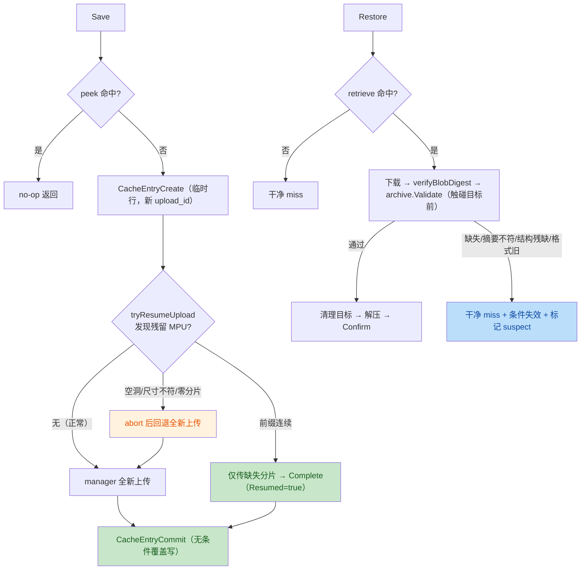

# 代码审查：可恢复的缓存提交（Resumable Cache Commit）

## 0. 审查范围与方法

- 审查对象：本 spec 对应工作区未提交变更（12 个已修改文件 + 4 个新增文件，见 `git status`）。
- 审查依据：[spec.md](file:///Users/ding/Documents/swe/0910081/project-01/.trae/specs/resumable-cache-commit/spec.md) AC-1..AC-10、[tasks.md](file:///Users/ding/Documents/swe/0910081/project-01/.trae/specs/resumable-cache-commit/tasks.md)。
- 审查方式：独立阅读全部生产代码与测试，**独立重跑**全部验证命令（不采信实施者声明）；e2e 因依赖组织云资源，按 tasks.md 约定以 fixture 静态走查为证据形式。
- 审查人：独立只读审查者；除本文件外未修改任何源码。

## 1. 变更概览

## 2. 检查点（Checkpoints）

| 检查点 | 关联 AC | 类型 | 结论 |
|---|---|---|---|
| CP-R1 | AC-1 成功路径 | rule | pass |
| CP-R2 | AC-2 部分上传失败不可恢复 | rule | pass |
| CP-R3 | AC-3 重启后继续/放弃 | rule | **fail**（e2e 证据缺陷，见 F1） |
| CP-R4 | AC-4 恢复失败不阻断保存 | rule | pass |
| CP-R5 | AC-5 缺失为干净 miss 并自愈 | rule | pass |
| CP-R6 | AC-6 旧格式识别与自愈 | rule | **fail**（e2e fixture 缺陷，见 F2） |
| CP-R7 | AC-7 失败不污染同进程后续命中 | rule | pass |
| CP-R8 | AC-8 重复 save/restore 幂等 | rule | pass |
| CP-R9 | AC-9 同进程独立 ctx 尽力 abort | rule | pass |
| CP-R10 | AC-10 可观察行为分类 | rubric | **fail**（放弃路径无用户可见文案，见 F1） |

### CP-R1（AC-1）— pass

- **独立证据**：[resumable_test.go](file:///Users/ding/Documents/swe/0910081/project-01/internal/cache/resumable_test.go#L165-L180) `TestResumableSuccess` 断言 `CacheEntryCreated=true`、`UploadSkipped=false`、`UploadID != ""`、mock 条目 `committed=true`，随后删除目标并断言 exact hit（非 fallback）、逐文件内容一致。
- 本人独立运行 `go test -race ./internal/cache/...`：`ok internal/cache 28.490s`。

### CP-R2（AC-2）— pass

- **独立证据**：[resumable_test.go](file:///Users/ding/Documents/swe/0910081/project-01/internal/cache/resumable_test.go#L184-L227) `TestResumablePartialUploadFailure` 只读存储注入上传失败，断言失败 save 留下的是未提交条目（或无条目）、restore 不命中，重存后命中且 **commit 恰好 1 次**。
- store 层 [resume_test.go](file:///Users/ding/Documents/swe/0910081/project-01/internal/cache/store/resume_test.go#L313-L369) 验证分片 403 后的 abort/错误语义。
- 服务端语义未变：未 commit 临时行不被 retrieve 返回，故"半成品不可命中"由服务端既有闸门保证。

### CP-R3（AC-3）— fail

- 单元证据本身充分：`TestS3ResumeUpload`（仅重传 part3、5 字节、对象一致）、`TestS3ResumeBadLayoutAborted`、`TestS3ResumeZeroPartsAborted`、`TestSweepStaleTempFiles`（超龄临时文件删除、未超龄保留、真实数据/sidecar 不触及），静态走查均成立。
- **但 Task 9 注册的 e2e 证据 [cache_interrupted_resume.yaml](file:///Users/ding/Documents/swe/0910081/project-01/internal/e2e/fixtures/cache_interrupted_resume.yaml#L55-L56) 存在缺陷**：第 56 行硬性 grep "resumed an incomplete multipart upload"，而 AC-3 明确允许"续传**或**中止后重传"。默认 uploader 并发度为 5，SIGTERM 落地时已完成分片集合经常含空洞（如 {3,4,7}），此时恢复走 abort 分支、不产生该文案 → e2e 在实现完全合法的情况下失败。详见 **F1**。

### CP-R4（AC-4）— pass

- **独立证据**：[resume_test.go](file:///Users/ding/Documents/swe/0910081/project-01/internal/cache/store/resume_test.go#L536-L614) `TestS3ResumeFailuresFallback` 分别注入 ListMultipartUploads 403、ListParts 403、缺失分片 UploadPart 403，三种情况下 Upload 均经回退路径成功且对象字节与源一致。
- 代码确认 [s3.go](file:///Users/ding/Documents/swe/0910081/project-01/internal/cache/store/s3.go#L354-L384)：resume 报错只记 Warn，随后 Seek 回绕并走 manager 上传，失败不可能阻断保存。

### CP-R5（AC-5）— pass

- **独立证据**：`TestResumableMissing`（纯 miss 与"条目无 blob"均返回 nil 错误、`CacheRestored=false`、目标未被修改，重存后命中）、`TestResumableStaleStructure`（空 blobs / 空摘要 → miss + mock 中条目被实际删除 + 重存命中）。
- 目标不被触碰的保证经代码核实：[restore.go](file:///Users/ding/Documents/swe/0910081/project-01/internal/cache/restore.go#L581-L587) 在构造 blob store、下载之前即返回 `errStaleEntryStructure`。
- 条件失效：[restore.go](file:///Users/ding/Documents/swe/0910081/project-01/internal/cache/restore.go#L458-L492) 以 retrieve 得到的 UploadID 为条件，且只有响应 `Existed=true` 才报告"已失效"，no-op 文案区分准确。

### CP-R6（AC-6）— fail

- 单元证据充分：manifest v1 → `ErrUnrecognizedFormat`（[manifest.go](file:///Users/ding/Documents/swe/0910081/project-01/internal/cache/archive/manifest.go#L73-L75)）、空 upload_id 发起**无条件** expire（`TestResumableOldFormats` 断言 expire 请求 `UploadID == ""`）、旧/缺/截断 sidecar 被容忍（`TestLocalFileBlobDownloadBadSidecar`）。
- **但 e2e 证据 [cache_corrupt_blob.yaml](file:///Users/ding/Documents/swe/0910081/project-01/internal/e2e/fixtures/cache_corrupt_blob.yaml#L46) 存在缺陷**：`aws s3 cp` 的 S3 URI 不解析 query string，`?region=us-west-2` 会成为对象键的字面后缀，写入的是新对象而非覆盖目标 blob。详见 **F2**。

### CP-R7（AC-7）— pass

- **独立证据**：[resumable_test.go](file:///Users/ding/Documents/swe/0910081/project-01/internal/cache/resumable_test.go#L231-L294) `TestResumableSuspectBlob`（同尺寸垃圾 blob → miss 后 save 断言 `UploadSkipped=false` 并实际覆盖 → restore 命中）与 `TestResumableArchiveValidationSuspect`（跳过摘要校验触发 Validate 失败 → `isBlobSuspect=true` → save 重传命中）。
- 代码核实：[client.go](file:///Users/ding/Documents/swe/0910081/project-01/internal/cache/client.go#L76-L94) 互斥保护 + 懒初始化，nil map 读取安全；[save.go](file:///Users/ding/Documents/swe/0910081/project-01/internal/cache/save.go#L390-L409) suspect 检查先于 Stat，任何 Stat 错误均按"未存储"处理（代价是一次上传，不会坏 save）。无 nil-map/nil-store panic 路径。

### CP-R8（AC-8）— pass

- **独立证据**：`TestResumableIdempotency`：连续两次 save（第二次 peek no-op、commit 仅 1 次、对象仅 1 个）；模拟重启（全新 client/空注册表指向同一存储目录）→ Stat 尺寸命中 → skip 上传 + commit，对象仍仅 1 个且 digest 与首次一致；完整条目连续两次 restore 均 exact hit；损坏地址两次均 miss。
- 续传路径同样幂等：缺失分片循环从 `len(parts)+1` 起步，校验保证 parts 为 1..n 连续前缀，不会重传或重复登记已存在分片。

### CP-R9（AC-9）— pass

- **独立证据**：`TestBestEffortAbortIndependentContext`（传入已取消 ctx，仍完成 abort）、`TestS3FailedUploadBestEffortAbort`（SDK abort 被 403 拒绝后独立 abort 成功；两次 abort 均被拒时 Upload 错误仍为原始 AccessDenied，不含 abort 错误）、`TestS3FailedUploadResumedNextSave`（abort 未成功的孤儿在下一次 Upload 被续传，仅重传 5MiB，对象字节一致）。
- 代码核实：[resume.go](file:///Users/ding/Documents/swe/0910081/project-01/internal/cache/store/resume.go#L253-L276) 使用 `context.WithoutCancel(ctx)` + 10s 超时的独立 ctx；abort 结果只记日志，不改变返回错误。

### CP-R10（AC-10）— fail（rubric）

- 已覆盖：成功（"Cache saved/restored successfully"）、部分失败（Upload 返回原始错误）、缺失（missing blob / digest mismatch / stale entry structure 四类互异文案，且区分"已失效"与 no-op）、旧格式（archive failed verification）、续传成功（[save.go](file:///Users/ding/Documents/swe/0910081/project-01/internal/cache/save.go#L299-L304) Info 文案）。
- **未覆盖**：AC-10 anchor 5 明确要求"续传**或放弃**"可观察，但 abort 路径在成功中止时**没有任何 Info 级输出**（仅 Debug "found resumable multipart upload"；abort 失败才有 Warn）。根因见 **F1**。
- 评分：**3/5**。五类场景四类文案明确，但"重启恢复"的放弃子路径与普通全新上传无法区分，且对应 e2e 只 grep 续传文案，达不到 anchor 4（本检查点按 fail 处理）。

## 3. 发现（Findings）

### 可执行发现（Actionable）

#### F1：abort 后重传路径无用户可见信号，且 e2e 硬性 grep 续传文案

- **位置**：[resume.go#L75-L94](file:///Users/ding/Documents/swe/0910081/project-01/internal/cache/store/resume.go#L75-L94)（零分片/坏布局的成功 abort 无 Info 日志）、[s3.go#L354-L371](file:///Users/ding/Documents/swe/0910081/project-01/internal/cache/store/s3.go#L354-L371)（返回错误包成 `errNoResumableUpload`，第 368 行 `errors.Is` 判定为"正常无残留"，连 Warn 都没有）、[cache_interrupted_resume.yaml#L55-L56](file:///Users/ding/Documents/swe/0910081/project-01/internal/e2e/fixtures/cache_interrupted_resume.yaml#L55-L56)。
- **问题**：
  1. 进程被杀时并发分片（默认并发 5）常留下含空洞的分片集合，恢复只能 abort 重传——这是 spec 明确允许的路径，但用户日志里与普通全新上传完全无区别，违反 FR-9/AC-10"续传或放弃"的可观察要求。
  2. e2e fixture 第 56 行只接受续传文案；走 abort 路径时 grep 失败 → `TestCacheInterruptedResume` 在实现合法时失败（时序相关，易 flaky）。
- **违反 AC**：AC-10（主）、AC-3（e2e 证据）。
- **建议方向**（不由审查者修复）：abort 成功时输出明确 Info（如 "aborted an incomplete multipart upload that could not be resumed, uploading again"），可引入区别于 `errNoResumableUpload`（"什么都没发现"）的哨兵以表达"发现并放弃了"；fixture grep 放宽为接受续传/放弃两种文案。

#### F2：corrupt blob fixture 的覆盖命令无法覆盖目标 blob

- **位置**：[cache_corrupt_blob.yaml#L46](file:///Users/ding/Documents/swe/0910081/project-01/internal/e2e/fixtures/cache_corrupt_blob.yaml#L46)。
- **问题**：`aws s3 cp garbage.txt "s3://buildkite-agent-e2e-tests-shared/${KEY}?region=us-west-2"`——AWS CLI 的 `s3` 命令将 URI 按字面切分，不解析 query string（见 awscli `find_bucket_key`），对象键会被写成 `${KEY}?region=us-west-2`。后果：目标 blob 仍为完好对象，restore 正常命中并创建 `cache-src/file.txt`，第 51-54 行检查失败、build 退出 1（CI 必现/场景实际未被演练）。
- **违反 AC**：AC-6（corrupt/old blob 自愈的 e2e 证据无效）。
- **建议方向**：改为 `aws s3 cp garbage.txt "s3://buildkite-agent-e2e-tests-shared/${KEY}" --region us-west-2`。

### 咨询性发现（Advisory，不阻断）

- **A1**：[restore.go#L229-L236](file:///Users/ding/Documents/swe/0910081/project-01/internal/cache/restore.go#L229-L236) 注释仍称"同尺寸时 save 会跳过、坏 blob 留存至过期"，与本次同处引入的 suspect guard（save.go#L391-L395）直接矛盾，属陈旧误导性注释，建议更新。
- **A2**：tasks.md Task 8 声称 cache_restore 帮助补充"无可用 blob → 干净 miss + 失效"，实际 [cache_restore.go#L85-L92](file:///Users/ding/Documents/swe/0910081/project-01/clicommand/cache_restore.go#L85-L92) 仅有"An incomplete search is distinguished from a miss"，该说明缺失（save 帮助已覆盖相关语义）。
- **A3**：同一对象键存在多个残留 MPU 时，每次 save 只处理 `ListMultipartUploads` 返回的第一个（[resume.go#L194-L215](file:///Users/ding/Documents/swe/0910081/project-01/internal/cache/store/resume.go#L194-L215)），其余依赖桶生命周期——spec Assumptions 已声明此假设，仅记录。
- **A4**：[restore_test.go#L119-L123](file:///Users/ding/Documents/swe/0910081/project-01/internal/cache/restore_test.go#L119-L123) 子测试因假 retrieve 响应缺少 `target_paths`，invalidate 在守卫处提前返回（运行日志 "retrieve response missing resolved address"），并未真正发起 expire；失效行为已由 `TestResumableStaleStructure` 覆盖，仅提示断言名与实际覆盖面略有出入。

## 4. 独立验证命令与结果（2026-10-09 由审查者实际执行）

| 命令 | 结果 |
|---|---|
| `go build ./...` | 通过（BUILD_OK） |
| `go test -race ./internal/cache/...` | 通过：cache 28.490s、archive 2.342s、store 4.374s、configuration (cached) |
| `go test -race ./clicommand/` | 通过：10.120s |
| `go tool gofumpt -extra -l internal/cache clicommand` | 无输出（格式合规） |
| `go vet -tags e2e ./internal/e2e/` | 通过（VET_OK） |

## 5. Review History

| 轮次 | 结果 | 说明 |
|---|---|---|
| Review R1 | **fail** | 存在 2 项可执行发现：F1（AC-10/AC-3：abort 路径无可观察信号 + e2e 硬 grep 续传文案导致合法 abort 路径下失败）、F2（AC-6：corrupt fixture 以 query string 传 region，无法覆盖目标 blob）。A1-A4 为咨询性发现。全部构建/测试/格式/vet 检查独立复跑通过。 |
| Review R2 | **pass** | F1、F2 均经独立代码核实已修复（errStaleUploadAbandoned 独立哨兵 + abandonUpload Info/Warn 可观察 + Upload 三分支安静分类 + fixture grep 双文案 + TestS3AbandonedSentinel；corrupt fixture 改 aws s3 cp 无 query URI + --region 独立参数，静态确认覆盖 $KEY）。CP-R1..CP-R10 全部 pass（AC-10 4/5）。全部构建/race（-count=1 绕缓存）/gofumpt/vet 独立复跑通过，无新增可执行发现，A2-A5 为咨询性。 |

---

# Review R2（2026-10-09）

## R2-0. 范围与方法

- 本轮针对 R1 的两项可执行发现（F1、F2）进行**独立复核**，不以 tasks.md 顶部 Issue I-1/I-2 的整改记录为证据；同时以全新视角重新走查 AC-1..AC-10 与全部生产代码/测试，确认修复未引入回归。
- 除本文件外未修改任何源码。e2e 仍依赖组织云资源，按既定约定以 fixture 静态走查 + 模板渲染（`go vet -tags e2e`）为证据形式。

## R2-1. F1 复核结论：已解决（resolved）

逐项独立核实如下：

1. **新哨兵独立于"什么都没发现"**：[resume.go#L40](file:///Users/ding/Documents/swe/0910081/project-01/internal/cache/store/resume.go#L40) 的 `errNoResumableUpload`（未发现任何残留，正常情形）与 [resume.go#L47](file:///Users/ding/Documents/swe/0910081/project-01/internal/cache/store/resume.go#L47) 的 `errStaleUploadAbandoned`（发现了残留但不可续传、已主动放弃）是两个不同的哨兵，注释语义清楚。
2. **两个坏分支均走放弃 helper**：零分片分支 [resume.go#L82-L87](file:///Users/ding/Documents/swe/0910081/project-01/internal/cache/store/resume.go#L82-L87) 与布局校验失败分支 [resume.go#L92-L97](file:///Users/ding/Documents/swe/0910081/project-01/internal/cache/store/resume.go#L92-L97) 都先调用 `b.abandonUpload`，再以 `%w` 包装返回 `errStaleUploadAbandoned`。
3. **放弃路径有可观察信号**：[abandonUpload](file:///Users/ding/Documents/swe/0910081/project-01/internal/cache/store/resume.go#L284-L292) 在 abort 成功时输出 **Info**："aborted an incomplete multipart upload that could not be resumed, uploading again"；abort 失败时输出 **Warn**。成功与失败两条子路径均不再静默。
4. **Upload 三分支分类不会误报**：[s3.go#L369-L378](file:///Users/ding/Documents/swe/0910081/project-01/internal/cache/store/s3.go#L369-L378) 明确区分三种情形——`errNoResumableUpload`（静默）、`errStaleUploadAbandoned`（静默，因决策已在 resume 路径内记录 Info）、其他意外错误才 Warn。**放弃路径既不会被误判为"什么都没发现"，也不会产生虚假 Warn**；Info 仅记录一次，无重复日志。
5. **哨兵不会逃逸或被吞掉**：全包检索确认两个哨兵仅在 `internal/cache/store` 包内使用，`tryResumeUpload` 的错误在 `S3Blob.Upload` 内被完整消费（非 nil 错误驱动回退到全新上传），不会以错误形式上传至 save.go；而放弃这一动作通过上述 Info/Warn 日志对外可观察，不存在"静默吞掉"。
6. **fixture grep 已放宽**：[cache_interrupted_resume.yaml#L57](file:///Users/ding/Documents/swe/0910081/project-01/internal/e2e/fixtures/cache_interrupted_resume.yaml#L57) 改为 `grep -Eq "resumed an incomplete multipart upload|aborted an incomplete multipart upload that could not be resumed" resume-save.log`，续传与放弃两种 AC-3 合法结果均被接受；第 54-55 行注释也同步更新。
7. **单元测试证明哨兵**：[TestS3AbandonedSentinel](file:///Users/ding/Documents/swe/0910081/project-01/internal/cache/store/resume_test.go#L454-L521)（坏布局、零分片两个子测试）断言 `errors.Is(err, errStaleUploadAbandoned)` 成立**且** `errors.Is(err, errNoResumableUpload)` 不成立，并断言假服务器上对应 upload `aborted=true`。断言强度充分，不存在"断言过弱"。

**结论：F1 的全部要求（独立哨兵、Info 级可观察信号、安静分类、fixture 双文案、单测）均已落实。**

## R2-2. F2 复核结论：已解决（resolved）

- [cache_corrupt_blob.yaml#L48](file:///Users/ding/Documents/swe/0910081/project-01/internal/e2e/fixtures/cache_corrupt_blob.yaml#L48) 现为：`aws s3 cp garbage.txt "s3://buildkite-agent-e2e-tests-shared/$${KEY}" --region us-west-2`——S3 URI 不含任何 query string，`--region` 为独立参数；第 46-47 行附有说明注释。
- **静态确认覆盖目标本身**：`$KEY` 来自第 40-43 行 `list-objects-v2` 对 `$PREFIX/` 的列举并从 `"Key": "..."` 中精确提取；[includes/cache_config.yml](file:///Users/ding/Documents/swe/0910081/project-01/internal/e2e/fixtures/includes/cache_config.yml) 只定义一个 cache（save 只产出一个对象），故 KEY 唯一。`aws s3 cp` 对该精确键发起 PUT，默认覆盖同凭证下的既有对象 `$KEY`，不再产生 `${KEY}?region=...` 字面后缀对象。
- 覆盖后 restore 下载同一键得到 27 字节垃圾内容，摘要校验（或尺寸校验）必然失败 → 干净 miss + 条件失效；随后 resave 以新摘要上传新对象，最终 restore 命中 "healed contents"。全链路静态走查成立。

**结论：F2 已修复，fixture 现在真正演练了"坏 blob → miss + 失效 → 重存自愈"。**

## R2-3. 更新后的检查点表（CP-R1..CP-R10）

| 检查点 | 关联 AC | 类型 | R1 结论 | R2 结论 |
|---|---|---|---|---|
| CP-R1 | AC-1 成功路径 | rule | pass | **pass** |
| CP-R2 | AC-2 部分上传失败不可恢复 | rule | pass | **pass** |
| CP-R3 | AC-3 重启后继续/放弃 | rule | fail（F1） | **pass** |
| CP-R4 | AC-4 恢复失败不阻断保存 | rule | pass | **pass** |
| CP-R5 | AC-5 缺失为干净 miss 并自愈 | rule | pass | **pass** |
| CP-R6 | AC-6 旧格式识别与自愈 | rule | fail（F2） | **pass** |
| CP-R7 | AC-7 失败不污染同进程后续命中 | rule | pass | **pass** |
| CP-R8 | AC-8 重复 save/restore 幂等 | rule | pass | **pass** |
| CP-R9 | AC-9 同进程独立 ctx 尽力 abort | rule | pass | **pass** |
| CP-R10 | AC-10 可观察行为分类 | rubric | fail（F1） | **pass（4/5）** |

### CP-R3（AC-3）— 由 fail 改判 pass

- F1 修复后，放弃子路径在日志中与续传同样可观察（Info 文案），e2e grep 同时接受两种合法结果；单元层面 `TestS3ResumeBadLayoutAborted`、`TestS3ResumeZeroPartsAborted`、`TestS3AbandonedSentinel`、`TestSweepStaleTempFiles` 均在本轮独立重跑中通过。

### CP-R6（AC-6）— 由 fail 改判 pass

- F2 修复后 e2e 的 corrupt 覆盖命令静态确认覆盖 `$KEY` 本身；manifest v1、空 upload_id 无条件失效、旧/缺/截断 sidecar 容忍（`TestLocalFileBlobDownloadBadSidecar`）的单元证据本轮独立复跑通过。

### CP-R10（AC-10，rubric）— 由 fail（3/5）改判 pass（4/5）

- 五类场景现在均有明确、互异的文案：成功（"Cache saved/restored successfully"）、部分失败（Upload 返回原始错误）、重启恢复（续传 "resumed an incomplete multipart upload left by a previous save" 与放弃 "aborted an incomplete multipart upload that could not be resumed, uploading again" 两条 Info）、缺失（missing blob / blob digest mismatch / stale entry structure 等互异原因串）、旧格式（archive failed verification）；no-op 与"已失效"由 [missCompleteMessage](file:///Users/ding/Documents/swe/0910081/project-01/internal/cache/restore.go#L563-L568) 严格区分，无 miss/命中误报。达到 anchor 4 门槛，未给 5 分仅因 restore 帮助文案仍缺一句直白说明（见咨询性 A2）。

## R2-4. 全 AC 新鲜视角复核（含 R1 既有正确性关注点）

- **非续传上传永不被服务**：未 commit 的临时行不被 retrieve/peek 返回（服务端既有闸门）；`TestResumablePartialUploadFailure` 断言失败 save 仅留未提交条目且 restore miss、重存后 commit 恰好 1 次。✅
- **partsFormResumablePrefix 健全性**（[resume.go#L175-L193](file:///Users/ding/Documents/swe/0910081/project-01/internal/cache/store/resume.go#L175-L193)）：分片号必须严格为 1..n 连续前缀（拒绝空洞 {1,3}、拒绝不从 1 起、重复）；除末片外每片必须恰为 partSize，末片必须等于 `size-(n-1)*partSize` 余数（拒绝分片尺寸不符、partSize>size 的异常情形）；partSize 取自 part 1 实际尺寸，对 S3 manager 的均匀分片约定可正确还原任意自定义分片大小；`len(parts) > expectedPartCount` 被拒。对象已存在的场景下内容寻址 + restore 摘要闸门保证安全（object 在 commit 前完成 → 新 save Stat 命中同摘要对象 → skip → commit）。✅
- **abort 使用独立不可取消 ctx**：[bestEffortAbortForKey](file:///Users/ding/Documents/swe/0910081/project-01/internal/cache/store/resume.go#L256-L279) 使用 `context.WithoutCancel(ctx)` + 10s 超时；`TestBestEffortAbortIndependentContext`（传入已取消 ctx 仍完成 abort）与 `TestS3FailedUploadBestEffortAbort`（SDK abort 被拒后独立 abort 成功；两次均被拒时 Upload 错误仍为原始 AccessDenied、不含 abort 错误）证明语义。✅
- **suspect-blob 守卫**：[client.go#L76-L94](file:///Users/ding/Documents/swe/0910081/project-01/internal/cache/client.go#L76-L94) 互斥保护 + 懒初始化，nil map 读取安全；[blobAlreadyStored](file:///Users/ding/Documents/swe/0910081/project-01/internal/cache/save.go#L390-L409) suspect 判定先于 Stat，同进程"摘要不符/归档校验失败后再 save"必发生实际上传，无 nil-map/nil-store panic 路径；restore.go 中两处 `Blobs[0]` 访问均在 downloadCache 已确认 Blobs 非空之后，索引安全。cache exec（[exec.go#L71-L102](file:///Users/ding/Documents/swe/0910081/project-01/internal/cache/exec.go#L71-L102)）Restore/Save 共用同一 client，守卫同样生效。✅
- **errStaleEntryStructure 路径**：仅由 [downloadCache](file:///Users/ding/Documents/swe/0910081/project-01/internal/cache/restore.go#L581-L587) 在构造 blob store/触碰目标前产生，Restore 的 `errors.Is` 分支将其降级为干净 miss + 条件失效；`TestRunRestore_Diagnostics/hit_without_downloadable_blob` 已从 R1 前的歧义硬错误改为干净 miss 文案。✅
- **幂等性**：重复 save → peek no-op、commit 仅 1 次、对象仅 1 个；重启后 save → Stat 同摘要尺寸命中 → skip + commit，对象/摘要不变；续传缺失分片循环从 `len(parts)+1` 起步且 parts 经验证为连续前缀，不重传已存在分片；重复 restore/重复 miss 结果一致（`TestResumableIdempotency` 三子测试）。✅
- **向后兼容**：空 UploadID → expire 请求 UploadID 为空即服务端无条件失效（`TestResumableOldFormats` 显式断言）；旧/缺/截断/非法 sidecar 下载容忍不 panic；manifest v1 → `ErrUnrecognizedFormat`。✅
- **修复未引入回归**：放弃哨兵在 Upload 中有独立 case，不会被归入"意外错误"而产生虚假 Warn，也不会被当作"什么都没找到"；Info 单次输出；相关测试断言（哨兵身份互斥 + aborted 标志 + grep 双文案）强度充分。✅

## R2-5. 独立验证命令与结果（2026-10-09 由审查者实际执行）

| 命令 | 结果 |
|---|---|
| `go build ./...` | 通过（BUILD_OK） |
| `go test -race -count=1 ./internal/cache/...` | 通过：cache 24.914s、archive 1.630s、configuration 1.774s、store 3.638s（`-count=1` 强制绕过测试缓存，为全新执行） |
| `go test -race -count=1 ./clicommand/` | 通过：9.911s（全新执行） |
| `go tool gofumpt -extra -l internal/cache clicommand` | 无输出，退出码 0（格式合规） |
| `go vet -tags e2e ./internal/e2e/` | 通过（VET_OK） |

## R2-6. 咨询性发现（Advisory，不阻断）

- **A1（已解决）**：restore.go 摘要不符路径的陈旧矛盾注释已更新（[restore.go#L229-L236](file:///Users/ding/Documents/swe/0910081/project-01/internal/cache/restore.go#L229-L236) 现与 suspect 守卫一致）。
- **A2（维持）**：[cache_restore.go#L85-L92](file:///Users/ding/Documents/swe/0910081/project-01/clicommand/cache_restore.go#L85-L92) 仍未直白写出"无可用 blob → 干净 miss + 失效"；save 帮助已覆盖相关语义，不影响行为。
- **A3（维持，属设计假设）**：同键多个残留 MPU 时每次 save 只处理 ListMultipartUploads 返回的第一个，其余依赖桶生命周期；spec Assumptions 已声明。
- **A4（维持）**：`TestRunRestore_Diagnostics/hit_without_downloadable_blob` 的假 retrieve 响应仍缺 `target_paths`，invalidate 在守卫处提前返回 false（故期望文案恰为 "entry may already have been removed..."）；实际失效由 `TestResumableStaleStructure` 覆盖。
- **A5（新增，仅记录）**：[cache_interrupted_resume.yaml#L39-L52](file:///Users/ding/Documents/swe/0910081/project-01/internal/e2e/fixtures/cache_interrupted_resume.yaml#L39-L52) 依赖"500MiB 无法在 12s 内传完（约需 >41.7MiB/s 持续吞吐）"这一环境假设；若 CI 网络极快致首次 save 完整提交，三次尝试后会以 "expected an in-progress multipart upload" 退出（属环境假设而非代码缺陷，R1 即存在，非本轮回归）。

## R2-7. 本轮结论

R1 的两项可执行发现 F1、F2 均已在代码中真正修复并有独立证据；CP-R1..CP-R10 全部 pass，全部构建/race 测试/格式/vet 检查由本人独立（绕缓存）复跑通过；未发现新的可执行发现，修复未引入回归。**R2 结果：pass。**
